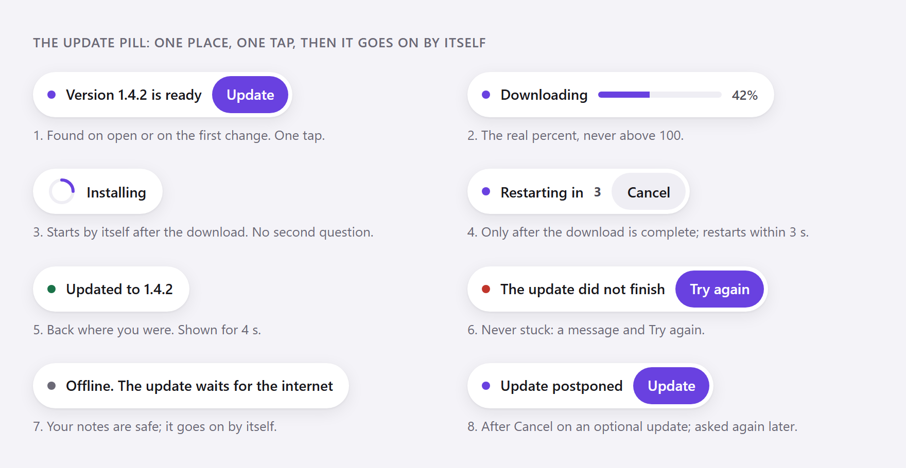
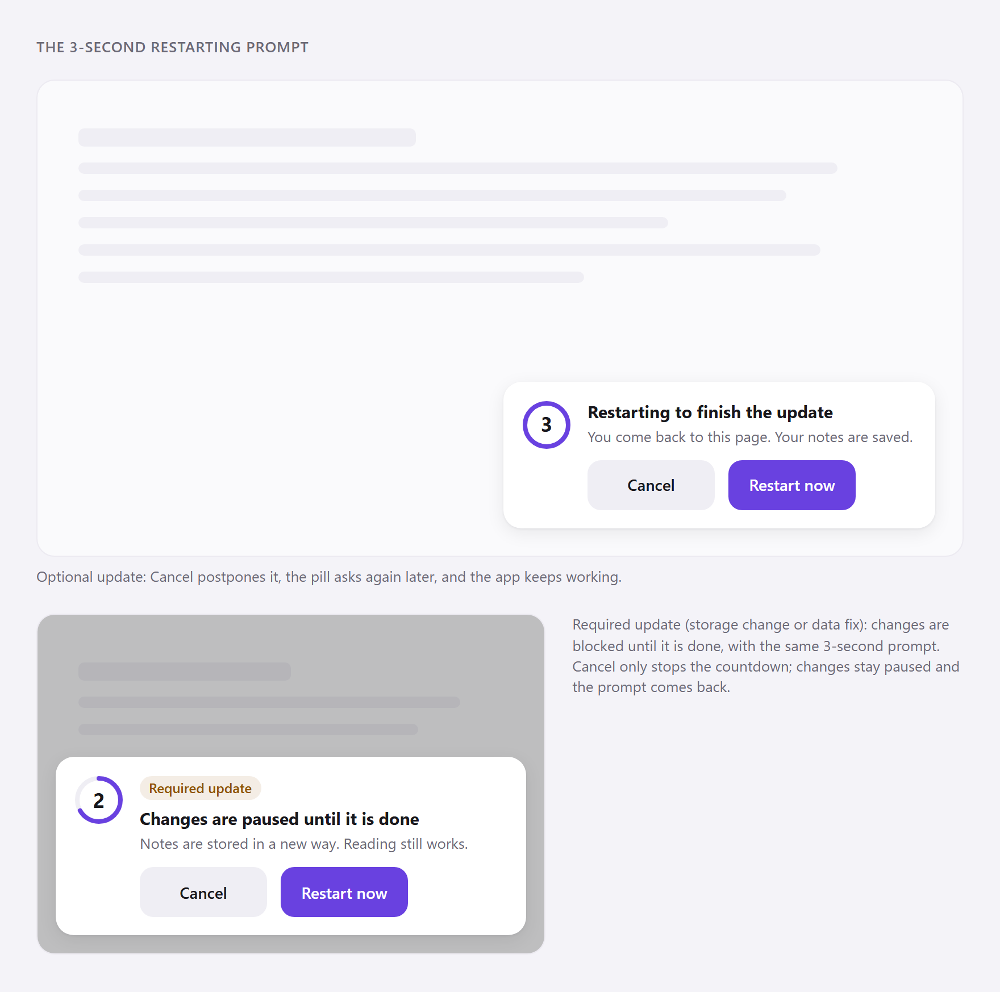
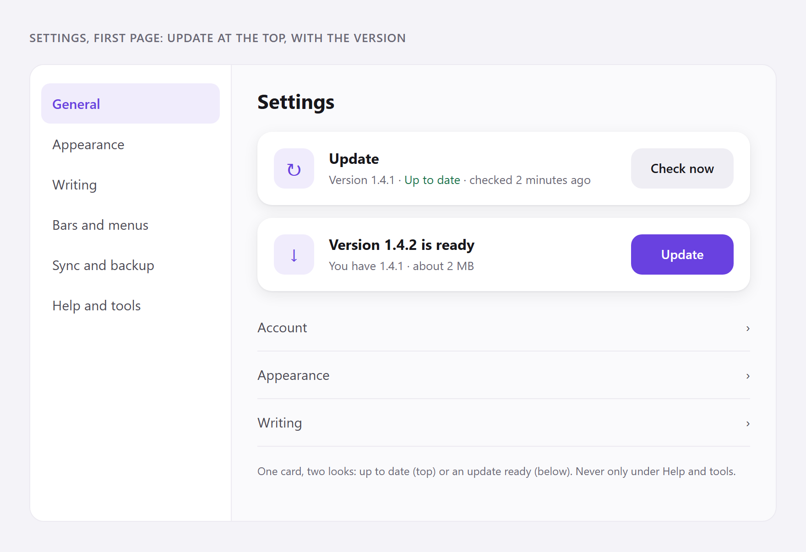
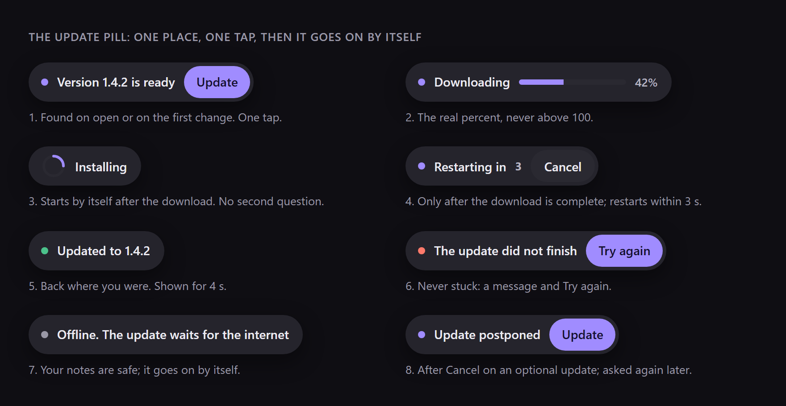
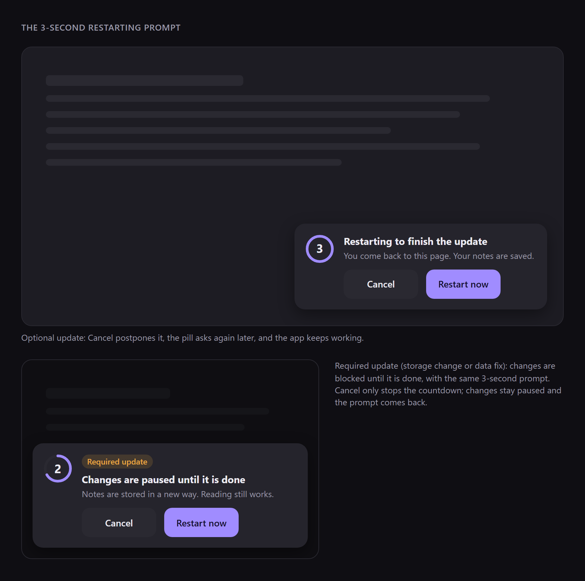
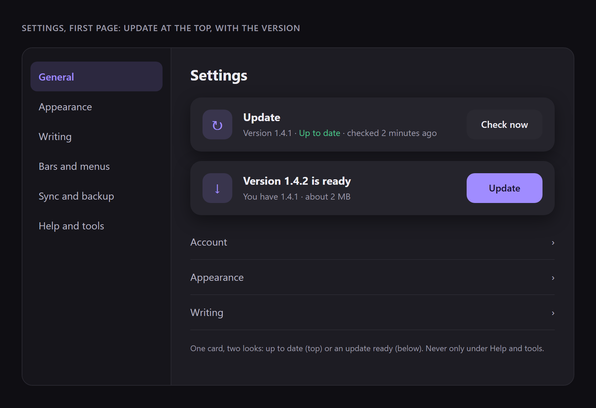

# Update flow v2 (template v2, method v2)

| Status | Stage | Switch      | Phase and parts                                | Pictures                                                                         | Builds on                                                                                                                                                                                             | Last change             |
| ------ | ----- | ----------- | ---------------------------------------------- | -------------------------------------------------------------------------------- | ----------------------------------------------------------------------------------------------------------------------------------------------------------------------------------------------------- | ----------------------- |
| Draft  | `1`   | `update.v2` | PC-1, parts U0a (found), U0b (spec), U0c (fix) | [docs/mockups/update-v3/](../mockups/update-v3/update-v3.html) (our own, 22 Nov) | this spec's slice 10 rules (kept in the bottom layer, nothing dropped); U0a's test `e2e/u0aUpdateRepro.spec.ts` on `origin/slice/u0a-update-repro`; parts: Status pill stack, Dialog set, Toast queue | 22 Nov 2026, Opus (U0b) |

<!-- Top layer for the owner, down to the confirm sheet. Bottom layer for the builders. Security rules: rules/security.md. -->

## Goal

After every release, one tap updates the app, it restarts within seconds and never loops.

## The two non-negotiables

1. **Never stuck.** Every state moves on by itself or shows a message with Try again.
2. **Nothing lost.** The app restarts on the same page; no note, typing or drawing is lost.

## Story

As the owner, who uses the installed app on the iPad every day, I want updates to work like an app store (one obvious tap, then it finishes by itself) so that a release never costs me five to ten minutes of loops.

## Picture

Our own pictures, made 22 Nov 2026 in our design tokens, in the spirit of the one-tap Update of the App Store, Microsoft Store and Play Store (one button that changes in place: Update, then progress, then done). No store art is copied. Not approved yet: rows 13 and 14 of the confirm sheet.

| The pill, step by step                                             | The 3-second prompt                                                | Settings, first page                                                               |
| ------------------------------------------------------------------ | ------------------------------------------------------------------ | ---------------------------------------------------------------------------------- |
|  |  |  |
|    |    |    |

## Rules

Each rule is one short line; the detail is in the scenarios.

**Always true**

- **Check often.** The app checks when it opens and on your first change.
- **One place.** The pill offers the download; one tap starts it.
- **Installs itself.** After the download it installs at once, no second question.
- **Three seconds.** "Restarting" shows a 3-second timer with Cancel, then restarts.
- **Same place.** After the restart you are on the same page and scroll place.
- **Optional can wait.** Cancel on an optional update postpones it; it asks again later.
- **Required blocks changes.** A storage change or data fix blocks changes until done.
- **Not while writing.** The prompt waits for a pause in writing or drawing.
- **Settings first page.** Update and the version sit at the top of Settings.
- **Real numbers.** The download shows its real percent, never above 100.
- **Fast.** From tap to the new version in under 30 s on a normal line.

**Must never happen**

- **UP-N1** Downloaded but not installed at once.
- **UP-N2** "Restarting" shown, no restart within 3 seconds.
- **UP-N3** Asked twice to restart.
- **UP-N4** After a restart the same version downloads again.
- **UP-N5** Reopening re-downloads an installed version.
- **UP-N6** Stuck anywhere without a message and a Try again.
- **UP-N7** Update or the version hidden in Settings.
- **UP-N8** Mandatory update lets you edit, optional update blocks you.

**Limits**

- No server or Supabase change; the version file stays a static file on the host.
- No restart while a save is still running; it waits up to 5 s, then says so.
- Offline: the update waits for the internet; your notes stay usable.

## Scenarios

What happens, not where to tap. Values from the owner's facts of 22 Nov 2026 (phase-pc-1.md section 18).

- **S1, the plain case (optional update).** Given the owner opens the app on the iPad after a release, when the pill says the new version is ready and the owner taps Update, then the download fills to 100%, it installs by itself, "Restarting in 3" counts down, the app restarts on the same page and says "Updated to" the new version. Asked once only. (UP-N1, UP-N2, UP-N3)
- **S2, a required update.** Given a release that changes how notes are stored, when the app finds it, then changes are paused (reading still works), the download runs, the same 3-second prompt restarts the app, and editing works again after. Cancel only stops the countdown; changes stay paused. (UP-N8)
- **S3, the thing that goes wrong (the owner's loop, on a slow line).** Given the iPad on a slow line, when the update downloads, then "Restarting" never shows before the download is complete; if the restart does not happen within 3 s, the pill says "The update did not finish" with Try again; Try again finishes it, with no loop. (UP-N2, UP-N6)
- **S4, after the update.** Given the update has installed, when the owner closes the app from the app switcher and opens it again, then no download starts and Settings says "Up to date" with the new version. (UP-N4, UP-N5)
- **S5, Settings.** Given any time, when the owner opens Settings, then the first page shows Update at the top with the version and either "Up to date" or an Update button. No digging into Help and tools. (UP-N7)
- **S6, Cancel an optional update.** Given an optional update in its 3-second prompt, when the owner taps Cancel, then the app keeps working, the pill says "Update postponed", and it asks again on the next open. (UP-N8)
- **S7, offline.** Given the iPad goes offline during the download, when it comes back online, then the download goes on by itself; notes stay usable all along. (UP-N6)

| Must-never line | Covered by |
| --------------- | ---------- |
| UP-N1           | S1         |
| UP-N2           | S1, S3     |
| UP-N3           | S1         |
| UP-N4           | S4         |
| UP-N5           | S4         |
| UP-N6           | S3, S7     |
| UP-N7           | S5         |
| UP-N8           | S2, S6     |

## What U0a found (the cause notes)

U0a built two real versions and swapped them while the app ran (`e2e/u0aUpdateRepro.spec.ts`, branch `origin/slice/u0a-update-repro`). In plain words:

- **The loop is real, in Safari's engine (WebKit), on a slow line.** The restart waits at most 15 s for the new version; when that runs out it reloads on the **old** version, which finds the update again and starts over: 3 restarts at 100 ms a file, 14 at 1000 ms a file; every file fetched twice.
- **"Restarting" shows too early:** while the download is only at 17 to 91 percent.
- **The percent goes over 100** (107% seen).
- **The host is not the cause:** version.json, sw.js and precache.json are sent with no-cache, as they should be.
- **Version line:** U0a added "Version abc1234 · Up to date" at the top of Settings behind `update.versionLine` (on the preview).

These match the owner's story: the download fills, "Restarting" sticks, Check says available, loop, works after 5 to 10 minutes.

## How we get there (the steps, each with its test)

| Step | What it gives                                                                   | Proved by                                                    |
| ---- | ------------------------------------------------------------------------------- | ------------------------------------------------------------ |
| 1    | U0a's `test.fail` lines (bug id U0) turned into plain red tests                 | the U0a spec red on ipad-webkit at 100 ms and 1000 ms a file |
| 2    | "Restarting" only after 100%; percent from real bytes                           | S1, S3 tests                                                 |
| 3    | Restart within 3 s or a message with Try again; never reload on the old version | S3 test, 20 of 20 on ipad-webkit                             |
| 4    | Installs by itself; one 3-second prompt with Cancel                             | S1, S6 tests                                                 |
| 5    | Required update pauses changes                                                  | S2 test                                                      |
| 6    | No re-download after a restart or a reopen                                      | S4 test                                                      |
| 7    | Update card on the first page of Settings                                       | S5 test, pictures side by side                               |
| 8    | The owner's check: PC first, then the iPad, by scenario                         | the owner's sheet answers                                    |

## Done when

S1 to S7 pass on chromium and ipad-webkit, 20 of 20; U0a's tests pass without `test.fail`; the owner says yes by scenario on the preview (PC, then iPad); with the switch off the app is exactly as today; one line in docs/metrics/tasks.csv.

## We assume (not proven yet)

- The installed iPad app behaves like WebKit at iPad size. Check: the owner's iPad check after U0c.
- The preview behaves like the live app. Check: U0a's host test, then the owner's preview check.

## Open points

- `OPEN:` **Your screenshots, please.** Next time the pill sticks on "Restarting" (or the loop starts), take a screenshot of the pill and one of Settings, and send them. They become the reference picture for S3.
- `OPEN:` The version shows as a short code today (abc1234); the pictures show a number (1.4.2). Row 15 asks which you want.
- `OPEN:` The Settings picture uses a placeholder side list; the real one comes from Settings v5 and the "Bars and menus" picture still to approve.

## Confirm sheet (the owner answers by row: Yes, Explain again, or Change to …)

| Row | Statement                                                                                       |
| --- | ----------------------------------------------------------------------------------------------- |
| 1   | The goal line says what I meant.                                                                |
| 2   | The two non-negotiables are right: never stuck, nothing lost.                                   |
| 3   | The app checks on open and on my first change.                                                  |
| 4   | After the download it installs by itself, with no second question.                              |
| 5   | "Restarting" shows a 3-second timer with Cancel, then restarts.                                 |
| 6   | Cancel on an optional update postpones it; it asks again next time.                             |
| 7   | A required update pauses changes until done; its countdown is 3 s (was 5 s), as a small prompt. |
| 8   | The prompt waits for a pause while I am writing or drawing.                                     |
| 9   | Update and the version are at the top of the first Settings page.                               |
| 10  | The eight must-never lines UP-N1 to UP-N8 are right and complete.                               |
| 11  | Scenarios S1 to S7 are right; S3 is my loop.                                                    |
| 12  | U0a's cause notes match what I saw.                                                             |
| 13  | The pill pictures (light and dark) look right.                                                  |
| 14  | The 3-second prompt and the Settings pictures look right.                                       |
| 15  | The version shows as a number like 1.4.2 (or: keep the short code abc1234).                     |
| 16  | Design and quality: the check list in the bottom layer is complete.                             |

---

## Bottom layer: for the builders

### Builds on

| Part card or spec                  | Used for                                                 |
| ---------------------------------- | -------------------------------------------------------- |
| Status pill stack                  | the update pill and its states (picture 1)               |
| Toast queue                        | the 3-second Restarting prompt (picture 2)               |
| Dialog set (alert)                 | the required-update pause notice and its failure states  |
| Overlay manager, Event router      | top layer; blocks edits while a required update runs     |
| Settings v5 (`settings-v5.md`)     | the Update card on the first page                        |
| U0a (`e2e/u0aUpdateRepro.spec.ts`) | the real two-build test, the trace, `update.versionLine` |

No gap, radius or timing rule is written here if a part card owns it.

### Plan

U0c: the fix behind `update.v2`. First failing test: U0a's WebKit loop at 1000 ms a file without `test.fail`. Files expected: `src/app/autoUpdate.ts` (restart wait, Restarting state), `src/app/updates.ts` (check triggers, re-download guard), `src/app/UpdatePill.tsx`, `src/settings/UpdateLine.tsx` (grows into the Update card), i18n `update.*`. No stored data change.

### Tasks

| Task | Satisfies            | Size    | Done when                                    |
| ---- | -------------------- | ------- | -------------------------------------------- |
| T1   | S3, UP-N2, UP-N6     | < 1 day | U0a loop tests green 20 of 20 on ipad-webkit |
| T2   | S1, S6, UP-N1, UP-N3 | < 1 day | S1, S6 green                                 |
| T3   | S4, UP-N4, UP-N5     | < 1 day | S4 green                                     |
| T4   | S2, UP-N8            | < 1 day | S2 green                                     |
| T5   | S5, S7, UP-N7        | < 1 day | S5, S7 green; pictures side by side          |

### Detail lines

- **UP-01** Check triggers: app open, first change after open, and today's throttled triggers (`app/updates.ts:249-293`).
- **UP-02** Download percent = received bytes / precache total, capped at 100; "Restarting" only when every file is cached.
- **UP-03** The restart waits for the new worker at most 3 s after the prompt ends; then the pill shows "The update did not finish" with Try again. It never reloads onto the old version silently (U0a: today it waits 15 s and reloads old).
- **UP-04** After a restart, a version equal to the running one is never downloaded again; a version already cached is installed, not fetched.
- **UP-05** Prompt: 3-second ring, Cancel and Restart now, 44 px buttons; waits while a stroke or typing is active (today's `isSafeMoment`, `app/autoUpdate.ts:46`).
- **UP-06** Required: decided by `level` (slice 10 rule 3 below); edits blocked through the Event router; reading and scrolling stay.
- **UP-07** Settings card: first item of Settings' first page. Up to date: version, "Up to date", last check, Check now. Update ready: new version, size, Update.
- **UP-08** Timings: pill states cross-fade 150 ms; reduced motion = instant, the numbers still change each second.

### Slice 10 rules, kept (nothing dropped)

The earlier version of this spec (slice 10, BUG-004). It stays unless a confirm-sheet row changes it; row 7 changes the required countdown from 5 s to 3 s and the full-screen notice into the 3-second prompt plus paused edits.

#### What makes an update "must-have" (exact rule)

Today (`vite.config.ts:36-51`, `src/app/updates.ts:128-136`): a build is "required" when its **own last commit message** contains `[required-update]` or `REQUIRED_UPDATE=1` is set. `version.json` carries `{ commit, required }`. The flag describes only the newest build, so a device on version A that skips the required build B and next sees a normal build C gets only the pill.

1. A new file `src/app/updateLevel.ts` exports `UPDATE_LEVEL` (a whole number, starts at 1) and `UPDATE_REASON` (`'storage'` or `'datafix'`).
2. The build writes `version.json` as `{ commit, required, level, reason }`. `required` keeps today's meaning for old devices.
3. A device treats a newer version as **must-have exactly when `level` in the live `version.json` is greater than the `UPDATE_LEVEL` it was built with.** Missing, non-numeric or negative `level` = not must-have (fail calm: the pill).
4. `UPDATE_LEVEL` goes up by 1 when, and only when, the highest `this.version(n)` in `src/core/db.ts` changes or a stored record shape changes (**storage**), or the release repairs saved data (**datafix**). A unit test pins `{ dbVersion → level }`.
5. A tab whose code is older than the database on this device is must-have at once, reason `storage`, without a network check.

#### When I do X → Y (slice 10 lines)

- **U1** Same `level` → the pill says the update is ready; never installs while writing or drawing.
- **U2** Higher `level` → the required flow within 1 s, with the reason line (countdown now 3 s, row 7).
- **U3** Skipped a must-have version (live `level` 2 above mine) → still the required flow.
- **U4** No `level`, a text `level` or a lower one → only the pill.
- **U5** Pause during the countdown → "Paused. The app needs this update to keep your notes safe." with Update now; edits stay blocked.
- **U6** Cancel during the download → Paused (U5); Update now starts again from 0.
- **U7** Download finishes → "Installing…", taps and keys blocked; restarts on the same page with the scroll place.
- **U8** Unsaved typing at "Installing" → waits up to 5 s for the save; if it fails: "Your last change is not saved yet" with Try again, no restart.
- **U9** No restart within 6 s → "The update did not finish" with Try again (tightened to 3 s by UP-03).
- **U10** Offline during a must-have update → "Connect to the internet to finish this update. Your notes are safe."; goes on by itself when online; never locks you out offline.
- **U11** A second tab already upgraded the stored notes → this tab shows the storage reason and does not write.
- **U12** Installed → "Updated to <version>" for 4 s.
- **U13** Switch off → exactly today's behaviour.
- **U14** (Professional, `about.version`) Settings shows version, `level`, Check now and last check time (now on the first page, UP-07).
- **U15** (Professional) Tap the reason line → a pop-up explains what changed.
- **U16** Reduced motion → nothing animates; the numbers still change.
- **U17** Screen reader → `alertdialog`; countdown announced once, not every second.

#### Nothing lost

| Today's feature                                                  | Where today (`src/`)                                 | New home                               |
| ---------------------------------------------------------------- | ---------------------------------------------------- | -------------------------------------- |
| Update pill phases (checking … failed)                           | `app/UpdatePill.tsx:8-58`, `app/updateStatus.ts`     | Status pill stack, states of picture 1 |
| Safe-moment install (idle, foreground, poll)                     | `app/autoUpdate.ts:16-109`                           | kept; the prompt waits for it (UP-05)  |
| Risk bar (unsaved, space, backup; Update anyway, Later)          | `app/UpdateBar.tsx:5-41`                             | Banner part, same texts and buttons    |
| Remember and restore place after update                          | `app/autoUpdate.ts:120`, `:140`                      | kept (S1)                              |
| "Restarting…" pill, 5 s cap                                      | `app/autoUpdate.ts:296-321`                          | 3-second prompt with Cancel (UP-03)    |
| Mandatory flow: countdown, download, pause, retry, install, fail | `app/mandatoryFlow.ts:17-173`, `MandatoryUpdate.tsx` | required flow, S2, U5 to U9            |
| Required marker in commit message                                | `vite.config.ts:36-51`                               | kept as `required` for old devices     |
| Required read from live `version.json`                           | `app/updates.ts:100-136`                             | plus the `level` rule                  |
| Update check throttling and triggers                             | `app/updates.ts:249-293`                             | kept, plus the first change (UP-01)    |
| Storage upgrade screen + rolling browser backup                  | `app/UpgradeGate.tsx:74`                             | kept; runs before install              |
| Check for updates now                                            | `settings/AboutSection.tsx`                          | Settings first page, Update card (S5)  |
| Version line                                                     | `settings/UpdateLine.tsx` (U0a)                      | grows into the Update card             |
| Other-tab apply message                                          | `app/updateChannel.ts:16`                            | kept; also carries U11                 |
| Test hook `learning-notes:test-required-update`                  | `main.tsx:203`                                       | kept (e2e)                             |

### Not in this part

- No forced update for an optional version; no "skip" for a required one.
- No server or Supabase change; no update channel switcher.

### Design and quality check

| #   | Check                                                                                        | Yes/no               | Pointer                                                                  |
| --- | -------------------------------------------------------------------------------------------- | -------------------- | ------------------------------------------------------------------------ |
| 1   | Looks like the approved picture (side by side before the owner's test).                      | no, not approved yet | docs/mockups/update-v3/, confirm rows 13 and 14                          |
| 2   | Meets docs/design/quality-standard.md (the premium look).                                    | yes                  | pictures use tokens only (`src/design/tokens.css`)                       |
| 3   | Follows docs/design/owner-ui-patterns.md.                                                    | yes                  | Cancel on the prompt; visible feedback at every step (picture 1, 1 to 8) |
| 4   | Accessible: keyboard path, labels, contrast, reduced motion.                                 | yes                  | U16, U17, UP-08; tokens pass `src/design/contrast.test.ts`               |
| 5   | Every text through i18n keys, in every language.                                             | yes                  | `update.*` keys in en, es, hi (Plan)                                     |
| 6   | Every change undoable with one Undo.                                                         | n/a                  | an update changes no note; Cancel covers the prompt                      |
| 7   | Speed budget stated and tested.                                                              | yes                  | rules "Fast" (30 s) and "Three seconds"; S1, S3 tests                    |
| 8   | Device-neutral: 44 px targets, no hover-only (mouse or Pencil), iPad later without redesign. | yes                  | UP-05; 44 px buttons in the pictures; S1 to S7 run on ipad-webkit        |
| 9   | Flexible: what is customisable, and where in Settings (simple default, advanced ▾).          | yes                  | nothing to set by default; Professional details U14, U15 under ▾         |

### Security check

The update downloads only from our own origin through the service worker; no new network target, no secret, no stored data change (rules/security.md). A required update can never be skipped, so old code never writes to a newer database (U11).

### Tests

- e2e (chromium + ipad-webkit): S1 to S7 by id, on U0a's two-build harness with the slow line at 100 ms and 1000 ms a file; U1 to U17 kept.
- Unit: percent cap, restart timeout, re-download guard, level compare, db-version → level pin.
- `@ipad`: the owner's check on the installed iPad app, by scenario.

### Changes

- 22 Nov 2026 · U0b · rewritten on template v2 from the owner's update flow, UP-N1 to UP-N8 and U0a's findings; slice 10 rules kept; required countdown 5 s → 3 s proposed (row 7) · waiting for the owner's sheet
